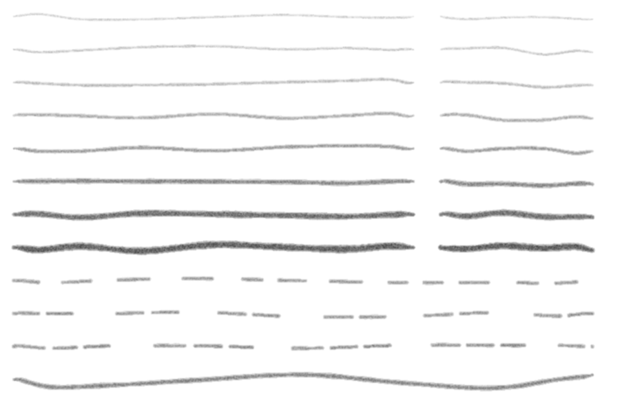
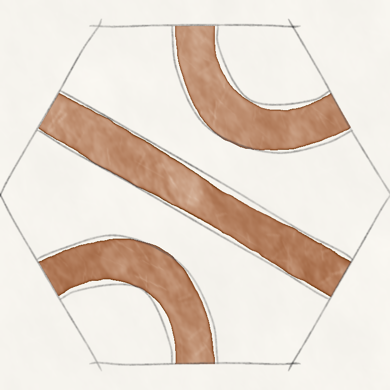

# almeraj-pencil

Hand-drawn pencil lines in Rust: an implementation of Zainab AlMeraj, Brian Wyvill, Tobias
Isenberg, Amy A. Gooch and Richard Guy, *Automatically Mimicking Unique Hand-Drawn Pencil Lines*
(Computers & Graphics 2009; first published at CAe 2008), and of AlMeraj's MSc thesis *Mimicking
Human-Drawn Pencil Lines* (University of Victoria, 2008).



A line is a **path** and a **texture**, and every line is different:

- **Path.** The hand moves from start to end along the minimum-jerk trajectory of Flash and Hogan
  (1985), sampled at the time steps of the paper's Table 1 (short lines get fewer control points,
  so they look straighter). Each control point is pushed sideways by a random *squiggle* of up to
  5 pixels, and a Catmull–Rom spline runs through them.
- **Texture.** The line is filled with random greys from the pencil's statistics — the centre from
  its centre histogram, the sides lighter, the bell-shaped fall-off of a real line — then a
  grey-level co-occurrence matrix measured from a real line reorders them: any neighbour pair the
  sample never shows is replaced, pass after pass. A 3 × 3 Gaussian finishes it. The width wanders
  along the line by gradient noise.
- **Dashes.** The study's three schemes: single dashes, pairs and triples, with Table 2's lengths
  and the 50–70 pixel gaps between groups.
- **Pencils** are statistics: `Profile::from_sample` measures a scanned line (roughly vertical, on
  white) exactly as the paper's Phase A does. The paper's own measurements are not published, so
  the eight built-in grades (2H, H, F, HB, B, 3B, 6B, 8B) are measured the same way from reference
  lines drawn procedurally: graphite in a bell across the line, catching on paper tooth. Scans of
  real pencils drop in unchanged.

No dependencies; deterministic for a seed.

## Departures from the paper

- **Curves.** The paper draws straight lines and leaves curves to future work. `path::along` lays
  the minimum-jerk profile along a curve's arc length and squiggles along its normal.
- **Centripetal Catmull–Rom.** Minimum-jerk timing crowds control points at the ends; on curves
  the uniform spline then loops near the tips, so the centripetal spline is used.
- **Squiggle near the tips** is limited to a slope of about 1:4, so the crowded end points don't
  bend every tip into a hook.
- **Co-occurrence correction stays within each pixel's zone** (centre, side, edge). Without that,
  replacements cascade and a line's tone drifts along its length. Measured pairs also count their
  neighbours within two grey levels, since a short sample leaves most of the 256 × 256 matrix
  empty by chance.
- **Tapering.** Long lines taper at their tips and short lines and dashes hardly do, as the study
  observed.

## Example

```rust
use almeraj_pencil::{Canvas, Grade, PathParams, Pencil, Rng, path};

let mut canvas = Canvas::new(300, 80);
let mut rng = Rng::new(7);
let params = PathParams::default();
let stroke = path::line([10.0, 40.0], [290.0, 40.0], &params, &mut rng);
canvas.draw(&stroke, &Pencil::new(Grade::B), 1.0, &mut rng);
let grey = canvas.to_grey8();
assert_eq!(grey.len(), 300 * 80);
```

`cargo run --release --example lines` draws the picture above.

## In use

Outlines over a watercolor tile from Bestagon, a hex puzzle game, with the
watercolor painted by [curtis-watercolor](https://github.com/jfernand/curtis-watercolor): the hex and
both sides of every path in 6B.



## Papers

Listed, with links, in [`docs/`](docs/README.md).

## Licence

MIT or Apache-2.0, at your option.
